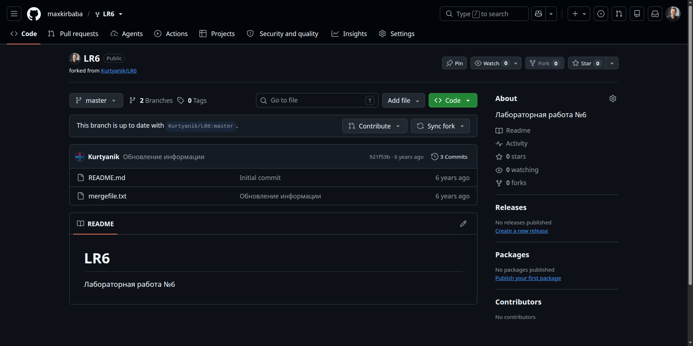
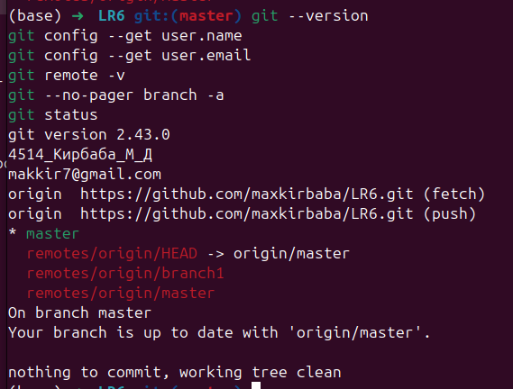
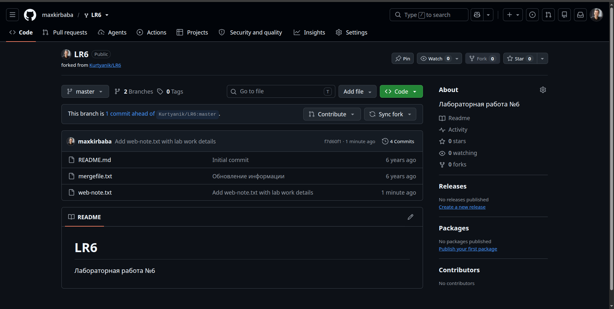
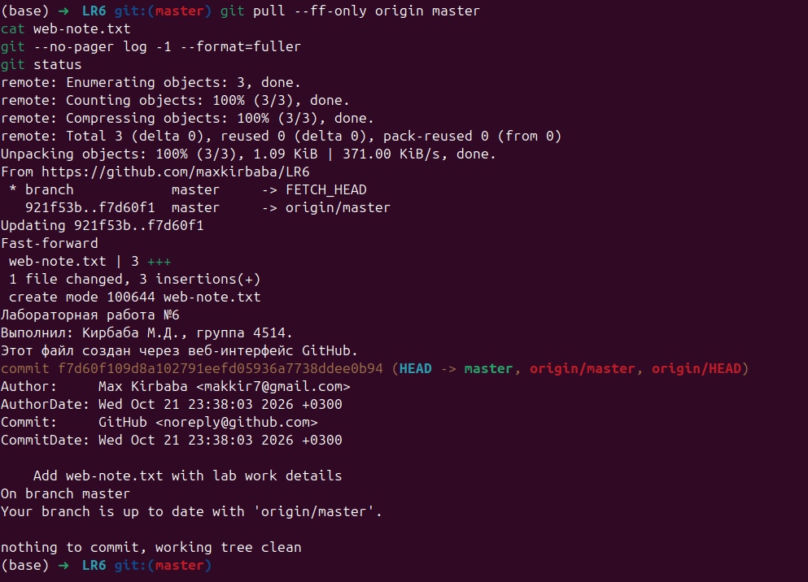
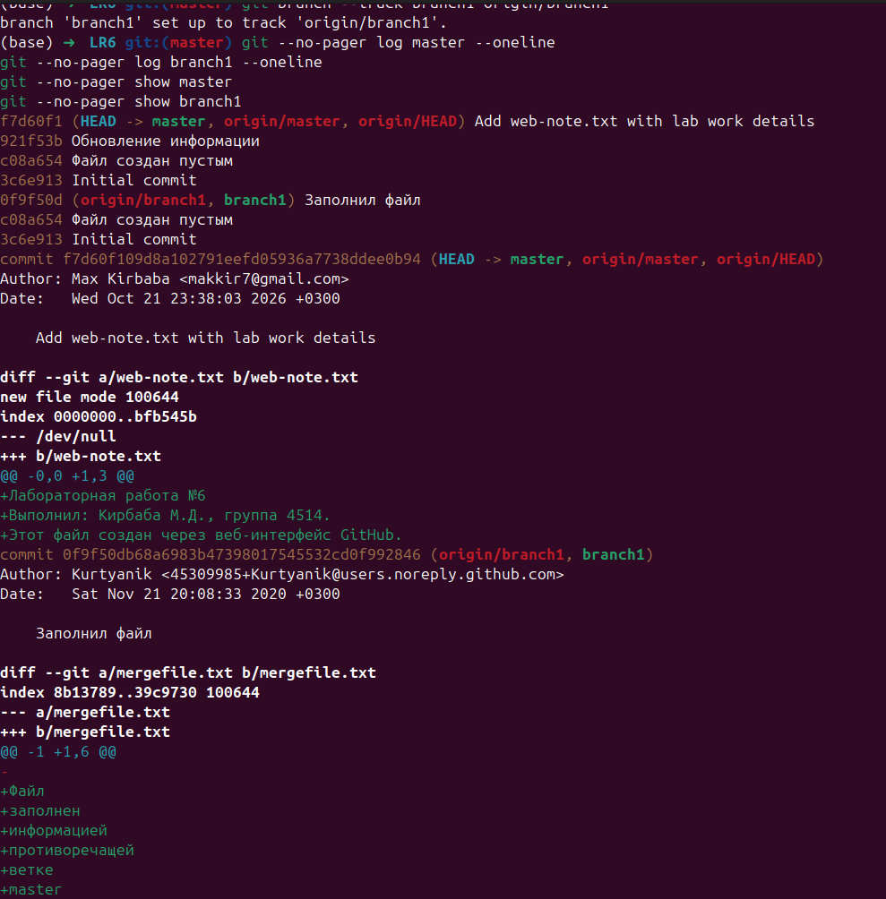
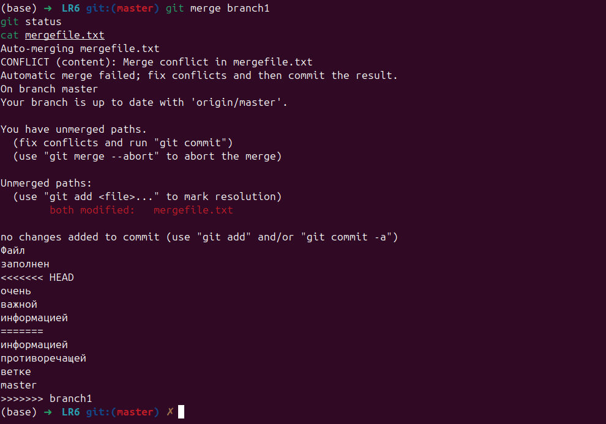
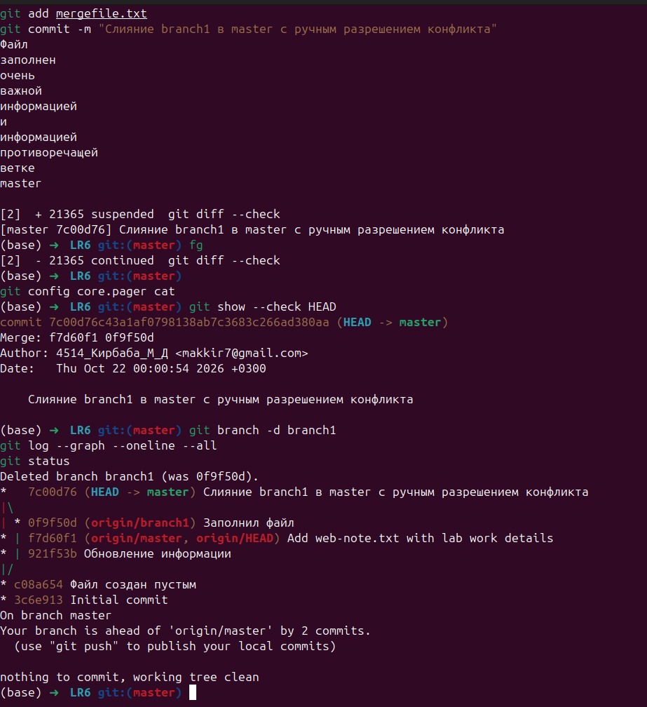
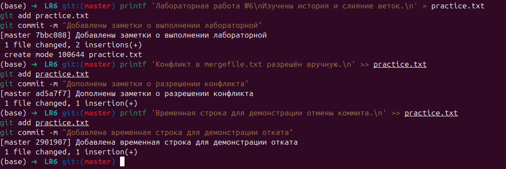
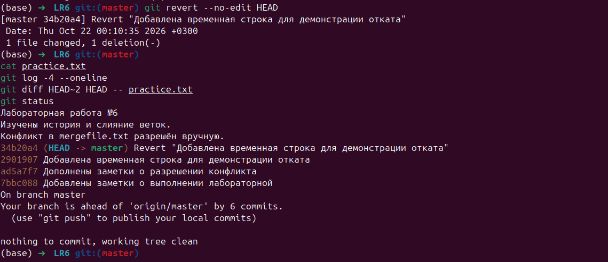
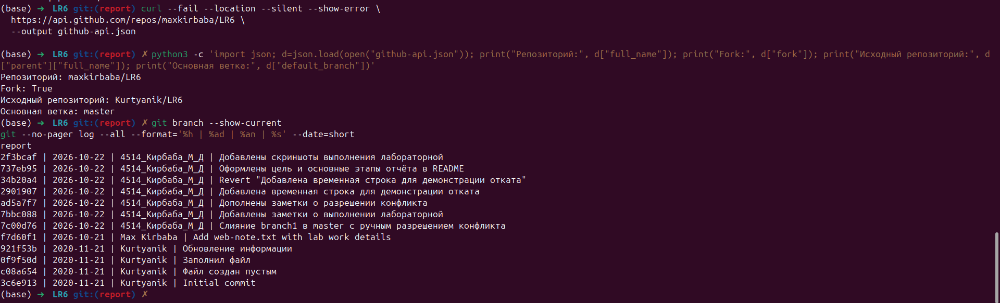

# Лабораторная работа №6. Система контроля версий

Выполнил: Кирбаба М.Д., группа 4514.
GitHub: https://github.com/maxkirbaba/LR6

## Цель работы

Изучить базовые возможности Git, получить опыт работы
с локальным и удалённым репозиторием и GitHub API.

## Ход выполнения

### Подготовка репозитория

Создан fork репозитория Kurtyanik/LR6 с ветками master и branch1.
Личная копия клонирована на компьютер.
Настроены имя и email автора коммитов.

### Получение изменений с GitHub

Через веб-интерфейс GitHub создан файл web-note.txt.
Коммит f7d60f1 получен локально командой git pull --ff-only origin master.

### История и слияние веток

Просмотрены история и последние изменения обеих веток.
При слиянии branch1 в master возник конфликт в mergefile.txt.
Конфликт разрешён вручную с сохранением текста обеих версий.
Создан коммит слияния 7c00d76, локальная ветка branch1 удалена.

### Создание и отмена коммитов

В practice.txt последовательно внесены изменения.
Созданы коммиты 7bbc088, ad5a7f7 и 2901907.
Последний отменён командой git revert --no-edit HEAD.
Коммит отмены 34b20a4 удалил временную строку, сохранив историю.

### Оформление отчёта

Создана отдельная ветка report.
Отчёт оформляется в README.md с использованием Markdown.
## Скриншоты выполнения

## Запрос к GitHub API

Выполнен GET-запрос к адресу:
https://api.github.com/repos/maxkirbaba/LR6

Ответ сохранён в github-api.json. Получены сведения:

- Репозиторий: maxkirbaba/LR6.
- Признак fork: true.
- Родительский репозиторий: Kurtyanik/LR6.
- Основная ветка: master.

## Журнал команд

[Команды без результатов выполнения](commands.log)

## Выводы

Освоены клонирование репозитория, получение изменений с GitHub,
просмотр истории и сравнение версий. Выполнено слияние веток
с ручным разрешением конфликта. Созданы последовательные коммиты,
последнее изменение отменено с помощью git revert с сохранением
истории. Выполнен запрос к GitHub API. Отчёт оформлен в Markdown
в отдельной ветке report.
